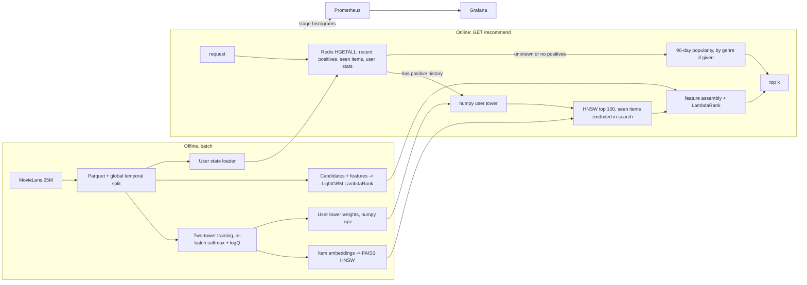

# recserve

A two-stage movie recommendation service on MovieLens 25M: a two-tower model
retrieves 100 candidates from 62,423 movies through a FAISS HNSW index, a
LightGBM LambdaRank model re-ranks them, and a FastAPI service serves the result
from Redis-backed user state with per-stage Prometheus metrics, inside a 50 ms
p99 latency budget.

| | result (test period) |
|---|---|
| Retrieval | two-tower Recall@100 **0.2823** vs 0.2216 for 90-day popularity (+27%) |
| Ranking | LambdaRank NDCG@10 **0.1436** vs 0.1143 in retrieval order (+25.7%, 95% CI +21.3% to +30.4%) and 0.0915 for popularity (+56.9%) |
| Serving | server p50 0.73 ms, p99 4.43 ms (single client); 3,000 req/s sustained at client p99 37 to 48 ms on 4 vCPUs |
| Simulated A/B | +11.0% click proxy overall (95% CI +8.3% to +13.7%), +44.8% for users with history; **offline replay, not a live test** |

Every number in this README is produced by a script in this repo and stored in
[`results/`](results) with the config, git commit, seed and hardware it came
from. `make report` regenerates [`results/summary_ml-25m.md`](results/summary_ml-25m.md).

## Contents

- [Problem](#problem)
- [Architecture](#architecture)
- [Data and split](#data-and-split)
- [Models](#models)
- [Serving](#serving)
- [Design decisions and tradeoffs](#design-decisions-and-tradeoffs)
- [Results](#results)
- [Load testing notes](#load-testing-notes)
- [Simulated A/B test](#simulated-ab-test)
- [Limitations](#limitations)
- [How to run](#how-to-run)
- [Repository layout](#repository-layout)

## Problem

Given a user, return the 10 movies they are most likely to rate highly next, out
of about 62K, within 50 ms at p99, including for users the system has never
seen. Scoring every item with a rich model is too slow and scoring them with a
cheap one is not accurate enough, which is the usual reason for the
retrieve-then-rank design used in recommendations, search and ads.

## Architecture



The API runs as 4 uvicorn workers in Docker next to Redis, Prometheus and a
provisioned Grafana dashboard (`docker-compose.yml`). The serving image has no
torch: the user tower runs in numpy.

## Data and split

- **Dataset**: MovieLens 25M (25,000,095 ratings, 162,541 users, 62,423 movies,
  genome tag scores for 13,816 movies). The download is MD5-checked and the
  CSVs are streamed straight into Parquet (154 MB).
- **Positives**: rating >= 4.0. All ratings are kept, because already-rated
  items are filtered out of recommendations and rating statistics are features.
- **Split**: one global time cutoff for everyone. Train is the first 90% of
  ratings by timestamp (to 2018-01-04), val the next 5% (to 2018-12-23), test
  the last 5% (to 2019-11-21). A per-user leave-last-out split lets a model see
  other users' later behaviour, such as what became popular, which a production
  system never can; a global cutoff rules that out and still keeps each user's
  train ratings before their val and test ratings.
- **Protocol**: for each evaluation period every model is fit on everything
  before it (train for val, train + val for test). Hyperparameters and epoch
  counts are chosen on val; test is used once.
- **Warm and cold users**: 10,669 users have a positive in the test period;
  4,727 had a positive before it (warm) and 5,942 did not (cold). Retrieval and
  ranking metrics are on warm users; cold users are served by the popularity
  fallback.
- **A caveat found in the data**: cold users make 60.1% of their test-period
  ratings within an hour of their first one (warm users 29.5%), and 22.7% of
  their positives are all-time top-100 movies (warm users 8.1%). That is
  MovieLens's sign-up flow, and it makes popularity look unrealistically strong
  on new users ([analysis](results/m1_cold_users_ml-25m.json)).

## Models

**Baselines** (`recserve/retrieval/baselines.py`): random, all-time popularity,
90-day popularity, and item-item co-occurrence (shrunk cosine, top 200
neighbours per item).

**Two-tower retrieval** (`recserve/retrieval/two_tower.py`)
- User tower: masked mean of the ID embeddings of the user's last 50 positives,
  their mean genre profile and log history length, through a 2-layer MLP. There
  is no user-ID embedding, so it works for any user with history and changes
  as soon as they rate something.
- Item tower: item-ID embedding, genres, release-year bucket and the 1,128-dim
  genome tag vector (projected), through a 2-layer MLP. Content features help
  items with few interactions.
- Both towers output 64-d L2-normalised vectors; the score is cosine.
- Training: next-item prediction (history = positives strictly before the
  target), in-batch sampled softmax over batches of 4,096, logQ correction,
  duplicate items in a batch masked, temperature 0.05. 11.06M examples per
  epoch, 4 epochs chosen on val, 4.17M parameters.

**LambdaRank ranker** (`recserve/ranking/`)
- 19 features: 6 user stats, 8 item stats (rating count and mean, 7-day and
  90-day popularity, days since first rating, release year, genome flag) and 5
  pair features (retrieval score and rank, genre affinity, genome tag cosine,
  release-year gap).
- Trained on val-period candidates from the train-only two-tower model, with
  20% of val users held out for early stopping (115 trees). Training on the
  retrieval model's own training data would make its scores look better than
  they are at serving time.
- Gain importance: genome similarity 16.6%, 7-day popularity 14.0%, retrieval
  rank 9.6%, release year 9.2%, days since first rating 8.2%, 90-day popularity
  8.1%.

## Serving

`GET /recommend?user_id=&k=&genres=` (`recserve/serving/app.py`)

| stage | what happens |
|---|---|
| feature_fetch | one async Redis `HGETALL`: last 50 positives, every rated item and 6 user stats as packed binary arrays |
| retrieval | numpy user tower, then HNSW search for 100 items with already-rated items excluded inside the search (FAISS ID selector) |
| ranking | features from the shared feature module, LightGBM predict on 100 rows, top k |
| cold start | unknown users and users with no positives get 90-day popularity, interleaved across `genres` if given, minus anything already rated |

Also `/healthz` (liveness), `/readyz` (models loaded, Redis reachable, user
state loaded), `/info` (active serving config) and `/metrics` (Prometheus
histograms per stage, aggregated across workers in multiprocess mode).

## Design decisions and tradeoffs

**Why two stages.** The two-tower model has to score 62K items in under a
millisecond, so user and item meet only in a dot product. The ranker sees 100
candidates and can afford cross features (genome similarity between the user's
history and the item, recent trend, the retrieval score itself), which is where
the +25.7% NDCG@10 comes from. Retrieval sets the ceiling: ranking can only
reorder what retrieval found (Recall@100 0.2823).

**Why in-batch negatives, and logQ.** The other positives in the batch are free
negatives and need no sampling pipeline, but they are drawn in proportion to
popularity, so without correction the model learns to push popular items down.
Subtracting each item's log sampling probability from its logit corrects that
(Yi et al., RecSys 2019). Duplicate items in a batch are masked so a positive is
never also a negative.

**HNSW parameters.** At 62K items exact search is already cheap (p99 0.28 ms on
one thread), so HNSW is here because it is what scales to millions of items.
M=16, efConstruction=200, efSearch=128 keeps 97.9% of the exact top 100 at p99
0.07 ms (4.0x faster than exact). M=32 adds 0.15 points of overlap for 32% more
memory.

**Filtering already-rated items.** Over-fetching k + |seen| and filtering
afterwards forces searches up to 2,048 deep for heavy raters. Passing the seen
items to FAISS as an ID selector keeps the search at k=100: in-process cost per
request fell from 1.14 ms to 0.56 ms and server retrieval p99 under load from
about 2.0 ms to 0.49 ms, for NDCG@10 0.1434 to 0.1428 on the serving path.

**Latency budget.** The design split of the 50 ms p99, against what was measured
server side at 3,000 req/s with the ID selector:

| stage | budget | measured p99 at 3,000 req/s |
|---|---|---|
| feature fetch (incl. event-loop wait) | 10 ms | 25.7 ms |
| retrieval | 10 ms | 0.49 ms |
| ranking | 10 ms | 1.34 ms |
| HTTP, serialisation, network | 20 ms | client p99 48 ms end to end |

The compute stages use a few percent of their budget. At high load the tail is
time requests spend waiting for their worker's event loop, which the
feature-fetch timer absorbs: the async Redis client on its own has p99 0.27 ms
at concurrency 8 ([diagnostic](results/diag_redis_ml-25m.json)).

**Cold start.** Users with no positive history get recent popularity, by genre
when the client passes the genres a new user picked. In the A/B simulation cold
users are 56% of active users.

**Training/serving parity.** Ranking features are computed by one torch-free
module used offline and online. The numpy user tower matches the torch
embeddings to within 3.3e-7 on 5,000 users
([diagnostic](results/diag_parity_ml-25m.json)), and the serving path
reproduces the offline NDCG@10 (0.1434 vs 0.1436) and Recall@100 (0.2824 vs
0.2823).

**Process isolation.** On macOS the pip wheels of torch, faiss and lightgbm each
bundle their own OpenMP runtime and abort when two are loaded in one process.
Training, the ANN benchmark and serving run as separate processes, the faiss
and serving tests run in their own pytest processes, and the API runs in Docker
(Linux), where this does not happen.

## Results

Hardware and configuration: Apple M4 (10 cores, 16 GB). Two-tower training on
the M4 GPU (PyTorch `mps`, 16 to 20 steps/s, 2.3 to 2.9 min per epoch);
everything else on CPU. Serving, load test and A/B simulation in a Docker
Desktop Linux VM (10 vCPUs, 8.2 GB). `configs/default.yaml`, seed 42, full
MovieLens 25M.

**Retrieval and ranking**, test period, 4,727 warm users, 62,423 items:

| model | Recall@100 | NDCG@10 | HitRate@10 |
|---|---|---|---|
| popularity, all time | 0.1255 | 0.0602 | 0.2513 |
| popularity, last 90 days | 0.2216 | 0.0915 | 0.3622 |
| item-item co-occurrence | 0.1911 | 0.0919 | 0.3503 |
| two-tower | 0.2823 | 0.1143 | 0.4650 |
| two-tower + LambdaRank | 0.2823 | **0.1436** | **0.5249** |

**ANN index**, 64-d item embeddings, 1 thread, k=100, 2,000 queries:

| index | build | size | p99 | overlap with exact top 100 |
|---|---|---|---|---|
| exact (flat) | 0.002 s | 16.0 MB | 0.280 ms | 1.000 |
| HNSW M=16, efSearch=128 | 3.7 s | 25.0 MB | 0.070 ms | 0.979 |

**Serving latency**, 1,000 sequential requests from one client (before the M5
filtering change): server p50 0.73 ms, p99 4.43 ms (feature fetch p99 0.43,
retrieval 2.95, ranking 1.18); client round trip p50 1.73 ms, p99 5.62 ms.

**Load test**, locust in a separate pinned container, 20 req/s per simulated
caller, 45 s per step. Sustained means achieved >= 95% of target, client p99 <=
50 ms and errors < 0.1%:

| variant | max sustained | client p99 there | server retrieval p99 there | NDCG@10 (serving path) |
|---|---|---|---|---|
| over-fetch (before) | 3,000 req/s | 37 ms | 2.03 ms | 0.1434 |
| FAISS ID selector (after) | 3,000 req/s | 48 ms | 0.49 ms | 0.1428 |

Both fail at 3,500 req/s (client p99 58 and 64 ms). At 4,000 offered the
selector achieved 3,838 req/s against 3,617. An earlier baseline run sustained
2,500, so treat the ceiling as plus or minus one step. Full step tables:
[`results/m5_summary_ml-25m.md`](results/m5_summary_ml-25m.md).

## Load testing notes

Three things distorted the first measurements; those runs are kept in
`results/`:

1. **Locust on the macOS host** competes with the Docker VM for CPU and goes
   through Docker Desktop's port forwarding. At 600 req/s it measured server
   p99 63.8 ms, against 13.8 ms with locust in its own container
   (`m5_load_ml-25m_baseline_host_locust.json` vs `m5_load_ml-25m_baseline.json`).
   Locust now runs pinned to vCPUs 5-9, the API to 0-3 and Redis to 4.
2. **Many slow connections**: at the same 400 req/s, callers at 5 req/s each
   (80 connections) gave server p99 50.5 ms, callers at 20 req/s each (20
   connections) 11.4 ms (`m5_load_ml-25m_baseline_5rps_per_user.json` vs
   `m5_load_ml-25m_baseline.json`). The cause is not fully isolated; CPU was not
   saturated. The reported runs use 20 req/s per caller, which models upstream
   services calling the recommender over pooled connections.
3. **Locust did not stop at overload**: one step ran 33 minutes instead of 45 s.
   The runner now kills a step that overruns and marks it invalid, reads
   Prometheus over the planned window only, and cools down between steps.

## Simulated A/B test

> **This is an offline simulation, not a live experiment.** No user saw these
> recommendations. Held-out test-period ratings stand in for clicks, so there is
> no position bias, no presentation or novelty effect and no feedback loop, and
> the ratings were shaped by the recommender MovieLens itself ran at the time.

- Population: the 10,669 users with a positive in the test period, split 50/50
  by a salted SHA-256 of userId (5,351 control, 5,318 treatment; sample ratio
  mismatch test p = 0.75).
- Control: 90-day popularity minus already-rated movies. Treatment: exactly
  what the API returns (`TwoStageRecommender.serve`).
- Click proxy: a user clicks if any of their top 10 is a held-out positive. One
  binary outcome per user, so the unit of analysis is the unit of
  randomisation.
- Pre-registration on the val period (+10% relative MDE, power 0.8, alpha
  0.05): 656 users per arm overall, 1,902 for warm users. Achieved: 5,318 per
  arm overall and 2,362 warm (power 0.88 for the warm segment).
- Statistics from [ab-testing-framework](https://github.com/arvindxyogesh/ab-testing-framework),
  vendored in `recserve/experiments/abtest_vendored.py`.

| segment | control | treatment | relative lift (95% CI) | p-value | P(treatment better) |
|---|---|---|---|---|---|
| all users | 67.2% | 74.6% | **+11.0%** (+8.3% to +13.7%) | 4.2e-17 | 1.000 |
| warm (has history) | 36.1% | 52.3% | +44.8% (+35.5% to +54.7%) | 4.2e-29 | 1.000 |
| cold (no history) | 91.9% | 92.5% | +0.6% (-0.8% to +2.2%) | 0.39 | 0.80 |

Checks: 1,000 A/A re-splits gave a 4.4% false positive rate at alpha 5%; cold
users get the same policy in both arms and show no significant difference; warm
click rates match offline HitRate@10 (0.362 and 0.525). The overall lift is
diluted by cold users by design, and their rates are inflated by the sign-up
behaviour described in [Data and split](#data-and-split).

## Limitations

- **Static snapshot.** Serving uses state as of 2018-12-23, the test cutoff.
  User state and item popularity are not updated online; production would need
  a stream job feeding Redis and the item tables, and periodic retraining.
- **Small ranker training set.** 3,516 users with a positive among their
  candidates. Rolling training windows would give the ranker more data.
- **Offline evaluation only.** Ratings are not clicks, and offline lift does not
  guarantee online lift.
- **Single machine.** The load generator and API share one host, in separate
  pinned vCPUs of one VM. The throughput ceiling varies by about one step
  between runs, and the slowdown with many connections is not fully explained.
- **Training is not bit-for-bit reproducible.** Seeds are fixed, but `mps`
  kernels are not deterministic: rerunning the two-tower moved test Recall@100
  from 0.2836 to 0.2823.
- **Event-loop tail.** Compute runs inline in the async handler. Moving it to a
  thread pool or batching requests is the next optimisation, not faster
  retrieval.

## How to run

Requires Python 3.11, Docker, and about 2 GB of free disk for data and
artifacts.

```bash
conda create -n recserve python=3.11 && conda activate recserve
pip install -e ".[dev,train,serve]"

# M1 data and baselines
make data            # download ml-25m.zip (262 MB), verify MD5, write Parquet
make split           # global temporal split
make baselines       # results/m1_baselines_ml-25m.{json,md}
make cold-users      # sign-up burst analysis

# M2 retrieval
make two-tower       # train (cuda > mps > cpu), evaluate, export val and test models
make ann             # HNSW vs exact search

# M3 ranking
make ranker          # LambdaRank on two-tower candidates

# M4 serving
make serving-artifacts
make up              # redis + loader + api + prometheus + grafana
curl "localhost:8000/recommend?user_id=1&k=10"
curl "localhost:8000/recommend?user_id=999999999&k=10&genres=Comedy,Drama"
make probe           # sequential latency probe

# M5 load test and optimisation
make serving-quality ARGS="--set serving.filter_mode=overfetch"
make load-test LABEL=baseline
make summarize-m5

# M6 simulated A/B test
make ab-test

# Diagnostics and summary
make diag-parity diag-redis
make report          # results/summary_ml-25m.md

make test            # unit tests + end-to-end smoke test on synthetic data
make test-serving    # API tests inside the Linux container
```

Every script takes `--config` and `--set key.sub=value` overrides. Host ports
can be changed with `API_PORT`, `REDIS_PORT`, `PROMETHEUS_PORT` and
`GRAFANA_PORT`; Grafana serves the dashboard at `/d/recserve`. CI (GitHub
Actions) runs ruff, the unit tests, the faiss and serving tests in separate
processes, an end-to-end smoke test on a synthetic MovieLens-shaped dataset,
and a Docker build.

## Repository layout

```
recserve/
  data/         download, temporal split, item features, synthetic data for tests
  retrieval/    baselines, two-tower model and training, FAISS helpers
  ranking/      shared feature code, LambdaRank training and evaluation
  serving/      artifacts build, Redis loader, numpy user tower, recommender, FastAPI app
  eval/         metrics (with reference implementations) and the evaluation harness
  experiments/  ANN benchmark, latency probe, load test, serving quality, A/B test, report
configs/        default.yaml (full ML-25M), smoke.yaml (synthetic CI run)
ops/            Prometheus config, Grafana provisioning and dashboard
results/        every reported number, with config, commit, seed and hardware
tests/          unit, smoke, faiss and serving tests
```
